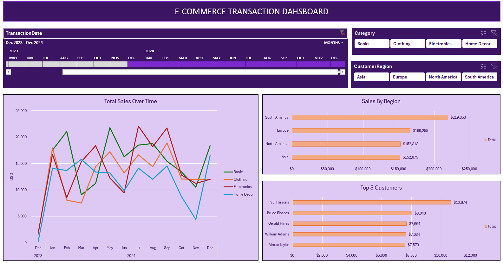

# E-Commerce Transaction Dashboard

## Project Overview
This project analyzes e-commerce transactions to track total sales, regional sales performance, and the top 5 customers by revenue. Raw transactional records were cleaned and processed in Microsoft Excel, and an interactive dashboard was built with timeline controls and filters (by Category and/or Region) to display dynamic charts.

- **Domain / Topic:** Retail Sales & Financial Reporting
- **Tech Stack / Tools:** Microsoft Excel

## Dashboard Overview



## Dataset & Data Preparation
Dataset used in this project is from Kaggle named "eCommerce Transactions" by Chad Wambles. This project only use `Customers.csv`, `Products.csv`, and `Transactions.csv`

- **Data Source:** [eCommerce Transactions by Chad Wambles](https://www.kaggle.com/datasets/chadwambles/ecommerce-transactions/)
- **Data Cleaning & Transformation:**
  - Check duplicate records on every tables
  - Using XLOOKUP and INDEX-MATCH to retrieve Customer and Product record into Transaction table
  - Remove time from the `TransactionDate` in `Transaction.csv` using DATEVALUE()
  - Create `Line Chart` and `Bar Chart` using Pivot Table to showcase Total Sales Over Time, Sales By Region, and Top 5 Customers.
  - Add `Timeline` and `Slicer` to make dynamic charts

## Project Structure
```text
E-Commerce-Transaction/
├── dataset/
│   ├── customers.csv
│   ├── products.csv
│   └── transactions.csv
├── src/
│   └── DashboardOverview.png
├── E-Commerce-Transaction.xlsx
└── README.md
```

## Future Improvements
- [ ] **KPIs:** Total unique customers and customer count per region.
- [ ] **Pie Chart:** Customer percentage distribution across regions.
- [ ] **Bar Chart:** Top 5 products by sales.